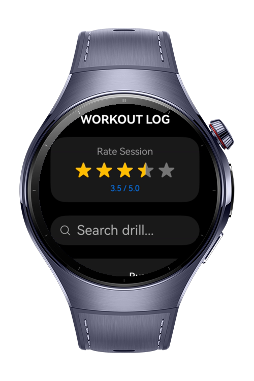
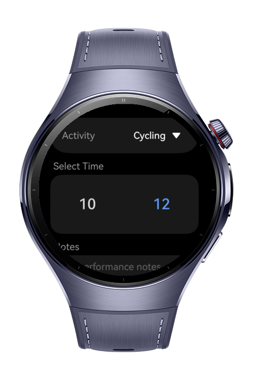
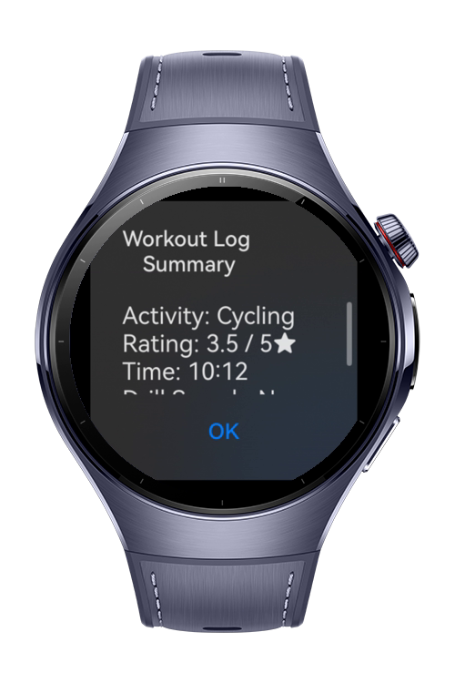
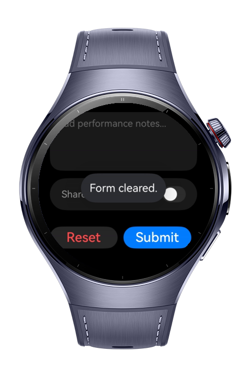

> **Note:** To access all shared projects, get information about environment setup, and view other guides, please visit [Explore-In-HMOS Index](https://github.com/Explore-In-HMOS/hmos-index).

# How to Build JS Form Controls

The app is a wearable-focused fitness logging application built for HarmonyOS / OpenHarmony. Implemented in both ArkTS (using MVVM architecture) and JS UI Framework, it features modular UI components, custom time/rating/notes inputs, and UIContext-driven toast and dialog prompts.

# Preview

<div>
  
  
  
  
</div>

# Use Cases

- **MVVM Architecture:** Clean separation of UI and business logic via `@Observed` ViewModels.
- **Wearable-Optimized Controls:** Embedded `TimePicker`, rating bar, custom text area, and toggle switches.
- **Modern HarmonyOS APIs:** Uses `UIContext` and `@kit.ArkUI` PromptAction for toasts and dialogs.

# Tech Stack

**Languages:** ArkTS
- **Frameworks:** HarmonyOS SDK, API version 6.0.1
- **Tools:** DevEco Studio 6.0.1 or later
- **Libraries & Kits:**
    - `@kit.PerformanceAnalysisKit`
    - `@kit.ArkUI`
    - `@kit.AbilityKit`
    - `@kit.BasicServicesKit`

# Directory Structure

```
main/
├── ets/                              # ArkTS Implementation
│   ├── components/                   # Reusable Modular UI Components
│   │   ├── WearableForm.ets          # Container Form Component with Action Buttons
│   │   ├── WearablePicker.ets        # Embedded TimePicker Component
│   │   ├── WearableRating.ets        # Interactive Star Rating Component
│   │   ├── WearableSearch.ets        # Search Input Component
│   │   ├── WearableSelect.ets        # Activity Selection Dropdown/List Component
│   │   ├── WearableTextArea.ets      # Custom Notes Input Component
│   │   └── WearableToggle.ets        # Switch / Toggle Component
│   │
│   ├── model/                        # Data Layer
│   │   └── WorkoutModel.ets          # Workout Data Interfaces & Data Models
│   │
│   ├── pages/                        # Main Application Screens
│   │   └── Index.ets                 # Main UI Entry Point (Compose Components & VM)
│   │
│   └── viewmodel/                    # Presentation / Business Logic Layer (MVVM)
│       └── WorkoutViewModel.ets      # State Management & UIContext Dialog/Toast Logic
│
└── js/                               # JS UI Framework Implementation
    └── MainAbility/                  # JS Ability Entry
        ├── app.js                    # Application Lifecycle Handler
        └── pages/
            └── index/                # Main Screen (JS Framework)
                ├── index.css         # Wearable Dark Theme Styles
                ├── index.hml         # UI Template Structure
                └── index.js          # Controller & Data Binding Logic
```

# Constraints and Restrictions
## Supported Devices

- HarmonyOS wearable Watch 5

# License

**How to Build JS Form Controls** is distributed under the terms of the MIT License.
See the [LICENSE](./LICENSE) for more information.